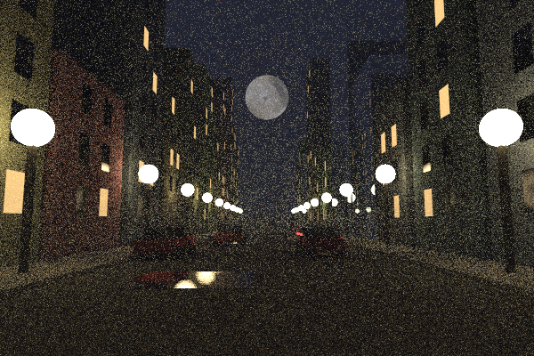
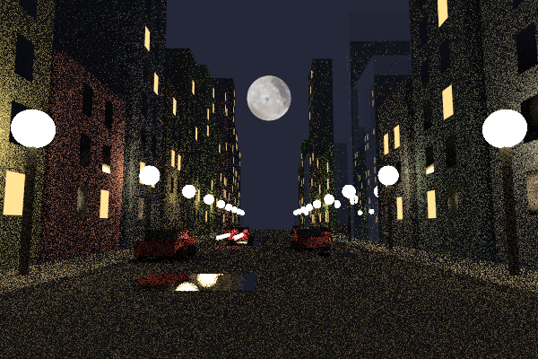

# Real-Time Path Tracer

A multithreaded Monte Carlo path tracer written from scratch in C++20, with a live
SDL3 window you can fly through. The image refines progressively as samples build up.



## Features

**Rendering**
- Monte Carlo path tracing with diffuse, metal, glass and emissive materials
- Volumetric fog and smoke
- Motion blur and depth of field

**Geometry and textures**
- Spheres, quads and boxes
- Instancing: translation, rotation, and movement over time
- Image, checker and Perlin noise textures

**Performance and interaction**
- BVH acceleration structure
- Multithreaded rendering with `std::thread`
- Progressive rendering that accumulates samples while the camera is still
- A fast, low-resolution preview while the camera moves
- Save the current render as a PNG with one key

## The night city

The final scene is my own, generated in code from a fixed random seed, so the same
city appears on every run:

- Rows of randomly sized buildings, some made of glass
- Lit and unlit windows, with the unlit ones reflecting the street
- Cars built from boxes and spheres: some parked, some driving with motion blur
- Street lamps, reflective puddles and a textured moon
- Two layers of fog: a thin haze over the street and a denser layer near the ground

| Without fog | With fog |
|---|---|
|  |  |

## How it works

Rays start at the camera and bounce randomly through the scene. A path only carries
color back if it reaches a light, and each surface it hits tints and dims that light.
Each pixel is the average of many random paths, so noise fades as samples accumulate.

## Controls

| Input | Action |
|---|---|
| W / A / S / D | Move |
| Q / E | Move down / up |
| Arrow keys | Look around |
| Mouse wheel | Zoom |
| P | Save the image as a PNG |

## Building

Requires Windows, Visual Studio with C++20, SDL3 and SDL3_image.

1. Install SDL3_image with JPEG support using [vcpkg](https://vcpkg.io/):
   ```
   vcpkg install "sdl3-image[jpeg]:x64-windows" --recurse
   ```
2. The project looks for SDL headers in `C:\SDL\include` and libraries in
   `C:\SDL\lib\x64`. Put them there, or change those paths in the project settings.
3. Open `raytracer.slnx`, select **Release | x64**, and run.

## What's next

- Importance sampling, to reduce the noise from small lights

## Credits

Based on the [Ray Tracing in One Weekend](https://raytracing.github.io/) book series.
The night city scene, live window, multithreading, camera controls, preview mode and
PNG export are my own additions.
