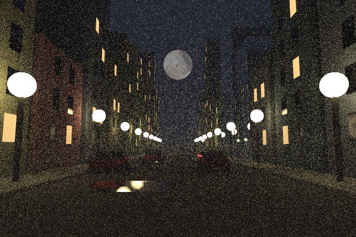
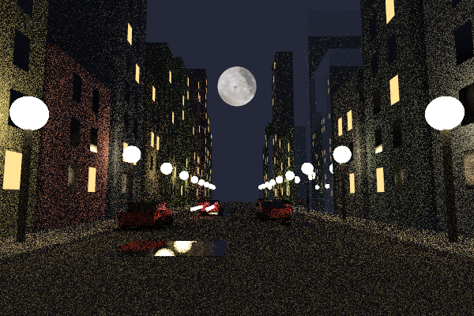

# Real-Time Path Tracer

A multithreaded Monte Carlo path tracer written from scratch in C++20, with a live
SDL3 window you can fly through. The image refines progressively as samples build up.



## Features

**Rendering**
- Monte Carlo path tracing with diffuse, metal, glass and emissive materials
- Volumetric fog and smoke
- Motion blur and depth of field

**Geometry and textures**
- Spheres, quads and boxes
- Instancing: translation, rotation, and movement over time
- Image, checker and Perlin noise textures

**Performance and interaction**
- BVH acceleration structure
- Multithreaded rendering with `std::thread`
- Progressive rendering that accumulates samples while the camera is still
- A fast, low-resolution preview while the camera moves
- Save the current render as a PNG with one key
- Optional Halton sampling for pixel positions, and a benchmark mode to measure it

## The night city

The final scene is my own, generated in code from a fixed random seed, so the same
city appears on every run:

- Rows of randomly sized buildings, some made of glass
- Lit and unlit windows, with the unlit ones reflecting the street
- Cars built from boxes and spheres: some parked, some driving with motion blur
- Street lamps, reflective puddles and a textured moon
- Two layers of fog: a thin haze over the street and a denser layer near the ground

| Without fog | With fog |
|---|---|
|  |  |

## How it works

Rays start at the camera and bounce randomly through the scene. A path only carries
color back if it reaches a light, and each surface it hits tints and dims that light.
Each pixel is the average of many random paths, so noise fades as samples accumulate.

## Halton sampling experiment

Random numbers clump, which is one source of noise. A Halton sequence spreads its
points evenly instead, and in my [Monte Carlo option pricer](https://github.com/Psyrofl/montecarlo-pricer)
it made prices up to 62× more accurate for the same number of samples. Both projects
use the same `sampling.h`.

Here, Halton chooses the position inside each pixel, using base 2 for x and base 3
for y. Each pixel adds its own fixed offset, from a hash of the pixel number, so
neighbouring pixels don't all sample the same spots at once.

**Result:** the error of 16-sample renders, measured against a 1,024-sample
reference, as the average pixel difference on a 0–255 scale:

| Render (16 samples) | Whole image | Edges | Everything else |
|---|---|---|---|
| Halton pixel positions | 36.98 | 42.80 | 36.65 |
| Random, run 1 | 37.11 | 44.38 | 36.69 |
| Random, run 2 | 36.26 | 42.34 | 35.91 |

Halton's result falls within the normal variation between two random runs, so it
gave no measurable improvement in this scene. The pixel position is only 2 of the
dozens of random numbers each path uses, and most of the noise comes from the light
bounces, which still use random numbers. Quasi-random sampling helps when it
chooses all of a sample's numbers, and when there are only a few of them. That's
why it worked so well for the pricer's single-step options, and not here.

To repeat the test, run the program from the `raytracer` folder with a mode and a
sample count. It saves a PNG at 16 samples and at the final count, then quits:

```
raytracer.exe halton 16
raytracer.exe random 16
raytracer.exe reference 1024
```

## Controls

| Input | Action |
|---|---|
| W / A / S / D | Move |
| Q / E | Move down / up |
| Arrow keys | Look around |
| Mouse wheel | Zoom |
| P | Save the image as a PNG |

## Building

Requires Windows, Visual Studio with C++20, SDL3 and SDL3_image.

1. Install SDL3_image with JPEG support using [vcpkg](https://vcpkg.io/):
   ```
   vcpkg install "sdl3-image[jpeg]:x64-windows" --recurse
   ```
2. The project looks for SDL headers in `C:\SDL\include` and libraries in
   `C:\SDL\lib\x64`. Put them there, or change those paths in the project settings.
3. Open `raytracer.slnx`, select **Release | x64**, and run.

## What's next

- Importance sampling, to reduce the noise from small lights
- Quasi-random sampling for the bounce directions too, not just the pixel positions

## Credits

Based on the [Ray Tracing in One Weekend](https://raytracing.github.io/) book series.
The night city scene, live window, multithreading, camera controls, preview mode,
PNG export and the Halton sampling experiment are my own additions.
